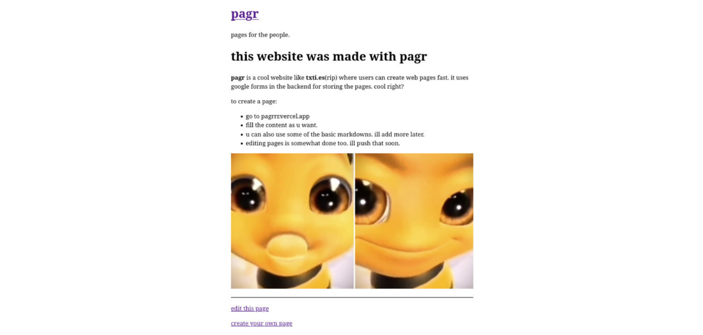

# pagr
a website like txti where u can create simple web pages fast. it uses google form (write) + google sheet (read) as the backend.

## setup
1. a google form with 3 questions: `slug`, `content`, `proof` (slug and content required)
2. in its google sheet and rename the responses tab to `pages`
3. share the sheet as "anyone with the link as viewer"
4. copy the form id, sheet id and the 3 `entry.xxxx` ids into `public/config.js`
5. run `python dev.py` and open http://localhost:8000

## how it works
- **write:** the browser posts a row to the form's `/formResponse` url
- **read:** it fetches every row for that slug and works out the current page
- the page has markdown. its rendered with marked and cleaned with dompurify every time they are shown
- nothing is ever deleted from the sheet, edits and deletes are just more rows.
- last version of each page is kept in `localstorage` (max 20) and shown first while the sheet is checked in the background

## ownership
on create the browser makes an ecdsa p-256 keypair. pubilc key goes in the `proof` column, the private part is edit code (shown once, kept in `localstorage`).

| proof column | meaning |
|---|---|
| empty | old page, can't be edited |
| `p1:<x>.<y>` | creates the page, holds the public key |
| `s1:<n>:<sig>` | edit number n |
| `d1:<n>:<sig>` | delete, final |

**rules when reading a page:**
- the oldest row with a empty or `p1:` proof is page
- edit counts only if its version is exactly (current version + 1) and signature matches its public key
- signature covers `[slug, version, action, content]`
- a valid delete ends the page, nothing after it counts

## addresses
- **random:** 6 characters, checked against the sheet before use
- **custom:** 3 to 32 of `a-z 0-9 -`, no dash at the start or end and few reserved words
- first come first served
- address never contain a dot, so they cant clash with real files like `/app.js`
